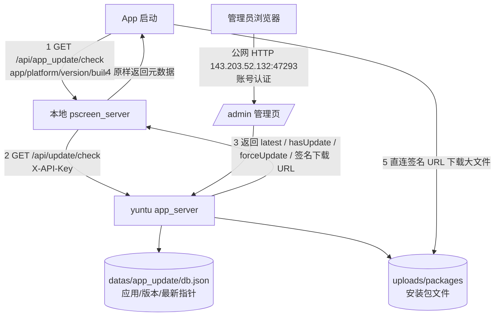

# 应用分发 / 更新管理实施方案（yuntu `app_server`）

> 状态：仅方案与文档，不含实现代码；不部署、不 commit、不 push。
> 目标仓库路径：`/home/honghao/codes/PotatokidClipboard/app_server/PLAN.md`
> 适用服务：yuntu（公网 IP `143.203.52.132`，Debian 12）+ 本地 `pscreen_server` + 各 Flutter 客户端。

---

## 0. 结论摘要

1. **yuntu 独占“应用/版本元数据 + 安装包存储 + 下载分发 + 管理页/管理 API + 客户端查询 API”**；本地 `pscreen_server` 只做**元数据代理**，不转发安装包字节，从而避开路由侠 1G 流量限制。
2. **“是否有新包”只比较 `build`（整数，单调递增）**；`version` 仅展示。最新版本按 **app + platform** 维度各自维护，不做全局最新。
3. **安装包下载走 yuntu 的临时签名直链（默认 10 分钟有效）**，客户端拿到 URL 后直连 yuntu 下载，不经本地 server；支持 Range 断点续传与签名防盗链。
4. **管理面走公网 HTTP（`47293`）+ 账号认证**，与客户端查询/下载端口（`47292`）分离；因运营商动态 IP **不启用 IP 白名单**，改为 ≥6 位密码（`password.minLength/maxLength` 可配置）、scrypt、双维度限流/锁定、12h 单点会话、二次确认与审计；TOTP 列为后续增强；无域名/证书阶段接受“管理凭据明文传输”的风险，并预留 HTTPS 开关（改配置即可启用，不重写）。
5. **旧包采用“空间自适应保留”**：每个 app+platform 最多保留 1 个 previous（共 2 版）；发布后旧包先归档不删，磁盘 ≥1.5GiB 时继续保留，<1.5GiB 时按归档时间升序清理最旧文件，<1GiB 停止上传；清理后下载返回 `300008`，元数据永久保留。
6. **大文件分片上传**：8MiB 分片、可断点续传、3 并发/上传、24h 超时清理；安装包上限 1GiB，上传前做磁盘与配额预检。
7. **运行期可变配置放在 `datas/app_update/`（git 忽略、rsync 双向排除）**，改 IP/端口只改该 JSON；本地代理支持 mtime 热加载，不需要重启 pm2。
8. **强制更新是单个 release 上的开关**（维度为 `appId + platform + releaseId`），不是应用级/全局策略。只有被设为 latest 的版本才可能强制；未开强更时最多提示、可跳过；iOS 不参与强制，只提示外部链接。
9. **查询失败一律放行**（`failMode=open`）：超时、上游不可达、本地未配置都正常进入主页，仅在后台记录异常，避免网络抖动误触发强更阻断。

---

## 1. 现状核实（来自仓库与机器的事实）

### 1.1 机器与环境

| 项 | 实测结果 |
|---|---|
| `ssh yuntu` | 可达；`hostname=vm21983-cur22028`，`whoami=root` |
| 系统 | Debian GNU/Linux 12 (bookworm)，内核级容器环境 |
| 资源 | 内存 960MiB（空闲约 336MiB，无 swap）；根盘 9.8G，**可用仅约 6.1G** |
| 已装 | `git`；**未装 Node.js / npm / pm2** |
| 端口占用 | `22`（sshd）、`12345`（docker-proxy）、`47291`（`/root/relay.py` HLS 中转）、`80/443/3478`（derper 容器） |
| 防火墙 | 无 ufw；iptables INPUT 默认 ACCEPT，仅挂 `ts-input` 链；依赖云厂商安全组 |
| 公网/内网 | 公网 `143.203.52.132`；Tailscale `100.68.15.110`（实测带宽仅几十 k/s，**不用于管理或上传**） |
| 仓库 | **yuntu 上没有 `/home/honghao`，也没有本仓库**；仓库实际在开发机 `100.83.142.107`（`honghao-MacBookPro12-1`）的 `/home/honghao/codes/PotatokidClipboard` |

> 因此本文档写入**实际仓库所在开发机**的 `app_server/PLAN.md`。yuntu 只作为部署目标，后续按第 8 节落地。

### 1.2 服务端技术栈与习惯

| 维度 | 现有 `pscreen_server` 做法 |
|---|---|
| 运行时 | Node.js + Express 5（`server/package.json`） |
| 依赖 | `express`、`multer`、`cookie-parser`、`ws`、`crypto`（均为纯 JS，无原生编译） |
| 路由风格 | 扁平 `/api/xxx`；管理端 `/api/admin/xxx`；静态页在 SPA 兜底前注册 |
| 响应格式 | `{ code, msg, data }`，成功 `code=0`（`server/definds.js`） |
| 鉴权 | 管理端 HMAC-SHA256 签名 Cookie `pk_admin`，TTL 7 天，`httpOnly`、`sameSite=lax`、`secure=false`；密钥落 `datas/admin/secret.key`；登录失败限流 8 次/10 分钟 |
| 密码 | `hashPassword` 统一存 MD5（兼容旧账号）；管理员用户名由 `ADMIN_USERNAME` 环境变量指定，默认 `honghao` |
| 静态页 | `express.static(build/web)`；`/admin` 路由 `sendFile(admin.html)`，见 `admin.js:1492-1499` |
| 配置 | `server/config.js` 读 `process.env.PORT` / `WEB_APP_PATH`；`production.config.js` 为历史遗留 |
| 数据存储 | `datas/` 下 JSON 文件（`machines.json`、`layouts.json`、`register/users/*`），无数据库 |
| 部署 | 源码仓库 `pscreen_server` → 部署目录 `/home/honghao/services/tools/{server,datas,uploads,build/web,backups}`；`pm2` 进程 `my-server`，`ecosystem.config.js` 固定 `cwd=__dirname`、`PORT=3000` |
| 同步 | 部署侧 `deploy.sh` 用 `rsync -a`（排除 `*.bak-*`、`datas/`、`uploads/`，无 `--delete`），并同步 `web/{admin,realtime,index}.html` 到 `../build/web` |
| 约束 | **禁止直接改部署目录**；先改源码 → 提交 → `deploy.sh push` |

### 1.3 已有的版本检查 / 升级逻辑

- **没有**任何“检查更新 / 版本接口 / 升级下载”的服务端或客户端实现。
- 已有的只是“展示与上报”：
  - `packages/pscreen_screen/lib/core/utils/app_version.dart`：`package_info_plus` 读取 `version` + `buildNumber`，仅用于设置页展示。
  - `pscreen_home/lib/core/server/device_reporter.dart:371` 读取 `version+build` 上报给本地 server。
  - `pscreen_server/server/realtime.js:682-712` 的 WS 握手已带 `app` / `version` / `build`，并写入设备表。
- 结论：**新建，不复用**（无重复轮子可复用）；但沿用现有的 `app/version/build` 字段命名、`code/msg/data` 响应格式、`defaultTargetPlatform.name` 平台枚举与 admin Cookie 鉴权思路。

### 1.4 各客户端真实标识

| 应用目录 | `pubspec` 版本 | Android `applicationId` | iOS / macOS bundle id |
|---|---|---|---|
| `pscreen_home`（Home 中控） | `1.0.2+5` | `potatokid.tools.homecontroller` | `potatokid.tools.homecontroller` |
| `pscreen/potatokid_screen`（TV） | `1.0.3+8` | `screen.potatokid.tools` | `screen.potatokid.tools` |
| `pscreen_control` | `1.0.0+1` | `com.example.pscreen_control` | `com.example.pscreenControl` |
| `client`（剪贴板） | `1.0.0+1` | `com.example.potatokid_clipboard` | `com.potatokid.clipboard` |

> 平台枚举直接复用 `defaultTargetPlatform.name`（`android/ios/macos/windows/linux`）；Web 端（`pscreen_server` 自身）不参与分发。

---

## 2. 整体架构与职责边界

### 2.1 职责

| 角色 | 负责 | 不负责 |
|---|---|---|
| **yuntu `app_server`** | 应用/版本元数据、安装包存储、签名下载、管理页、管理 API、客户端查询 API、下载统计、清理 | 不侵入各 App 业务；不保存用户隐私数据 |
| **本地 `pscreen_server`** | 提供固定的内网/路由侠入口；按 `datas/app_update/config.json` 指向 yuntu；代理查询；短 TTL 缓存与降级 | 不存储安装包；不转发大文件字节；不暴露 yuntu API Key |
| **App** | 启动时携带 `app/platform/version/build` 查询；当且仅当该平台 latest 版本 `forceUpdate=true` 且本地 build 落后时阻断进入主页；校验 `sha256` 后安装 | 不硬编码 yuntu 地址；不携带任何服务端密钥 |

### 2.2 数据流



关键点：**第 5 步不经过本地 server**，这是带宽受限下的核心设计；管理面与业务面端口分离，便于单独限流/审计/未来切 HTTPS。

### 2.3 时序（启动自检：提示更新 / 强制更新 / 失败放行）

```text
App 启动 → 查本地 server → yuntu 返回该平台 latest（build=8）
        ├─ 查询失败/超时/本地未配置        → 记录异常 → 直接进入主页（failMode=open）
        ├─ 本地 build=8（已最新）           → 直接进入主页
        ├─ 本地 build=5 且 latest.forceUpdate=false → 可跳过提示（默认策略）→ 进入主页
        ├─ 本地 build=5 且 latest.forceUpdate=true  → 不可关闭的“必须更新”页（下载 + 重试）
        │                                             → sha256 校验 → 系统安装 → 重启后再判定
        └─ platform=ios（无法自更新）      → 仅提示并给出 TestFlight/商店链接，不阻断
```

> `forceUpdate` 是**该 release 自身的开关**，不是“所有 App 一律强更”。同一个 app 的其它平台、或同平台的历史版本，都不受这次标记影响；只有“当前平台 latest 且 `forceUpdate=true`”才会阻断。**查询失败不是强更**：任何网络异常都放行，避免抖动误锁用户。

---

## 3. 数据模型

存储介质沿用仓库习惯：**JSON 文件 + 原子写（临时文件 + `rename`）+ 进程内串行锁**，不引入数据库与原生依赖。单文件 `datas/app_update/db.json`，结构如下。

### 3.1 `applications`

| 字段 | 类型 | 说明 |
|---|---|---|
| `appId` | string | 业务标识，主键；小写字母/数字/连字符，2–48 位，如 `potatokid-home` |
| `name` | string | 展示名 |
| `description` | string | 说明 |
| `platforms` | string[] | `windows/apk/ios/macos/linux` 子集 |
| `enabled` | bool | 停用后查询返回“无更新”或按配置报错 |
| `createdAt` / `updatedAt` | ISO string | 时间 |

> 注意：对外平台值用 `apk` 而不是 `android`，与需求一致；客户端把 `defaultTargetPlatform.name == 'android'` 映射为 `apk`。

### 3.2 `releases`

| 字段 | 类型 | 说明 |
|---|---|---|
| `releaseId` | string | 主键，`rel_<yyyymmddHHMMSS>_<6位随机>` |
| `appId` | string | 外键 |
| `platform` | enum | `windows/apk/ios/macos/linux` |
| `version` | string | 展示用版本号（如 `1.0.3`），**不参与比较** |
| `build` | int | 正整数，**唯一且单调递增**，判定新旧唯一依据 |
| `filename` | string | 原始文件名（仅展示/下载时 Content-Disposition） |
| `storedPath` | string | 相对 `uploads/packages` 的路径 |
| `size` | int | 字节 |
| `sha256` | string | 上传时流式计算；iOS 外部链接版本为空 |
| `distribution` | enum | `file`（自托管安装包）/ `external`（仅外部链接，iOS 用） |
| `externalUrl` | string\|null | `distribution=external` 时的 TestFlight / App Store / 商店链接 |
| `fileAvailable` | bool | 文件是否仍在磁盘；空间自适应清理后置 `false`，元数据保留 |
| `fileDeletedAt` | ISO string\|null | 文件被清理（物理删除）的实际时间 |
| `notes` | string | 更新说明，≤ 2000 字 |
| `forceUpdate` | bool | **该 release 自身的强制更新开关**；维度为 `appId + platform + releaseId`，不是应用级/全局开关；`platform=ios` 恒按 `false` 生效 |
| `status` | enum | `draft / published / archived` |
| `publishedAt` | ISO string\|null | 发布/设为最新时间 |
| `archivedAt` | ISO string\|null | 被新版本取代（进入 previous）的时间；清理顺序依据 |
| `createdAt` | ISO string | 上传/创建时间 |
| `downloadCount` | int | 累计下载次数 |
| `lastDownloadAt` | ISO string\|null | 最近下载时间 |
| `uploadedBy` | string | 管理员名 |

> **`forceUpdate` 的生命周期**：上传时可勾选；`draft` 状态下不对外生效；发布/设为 latest 后生效；被新版本取代后**自动失效**（历史版本上的强更标记只保留记录，不再影响任何客户端）。关闭强更只是把该字段改回 `false`，**不删除文件、不需要重新上传**。

### 3.3 最新版本指针

```json
{
  "applications": { "potatokid-home": { "...": "..." } },
  "releases": { "rel_20261105120000_a1b2c3": { "...": "..." } },
  "latest": {
    "potatokid-home": {
      "windows": "rel_20261105120000_a1b2c3",
      "apk":     "rel_20261105093000_d4e5f6"
    }
  },
  "stats": {
    "daily": { "2026-11-05": { "potatokid-home|windows": 3 } }
  }
}
```

**语义：按 `appId + platform` 各自维护“最新”**。理由：

- 各平台构建节奏不同（Windows 安装包、APK、iOS 包天然分离）；
- 若做全局最新，任一平台发版会误伤其它平台；
- 客户端只关心自己平台的版本，接口也按平台返回。

> **“最新”与“强制”的关系**：`forceUpdate` 只对 **latest 指针当前指向的 release** 生效。历史版本即使历史上开过强更，也不会让客户端升级到它；因此管理端只允许对“当前 latest”切换强更，避免把强制标记打在被替代的版本上。若把旧版本 `rollback` 为 latest，则以该旧版本的 `forceUpdate` 为准，但客户端 build 更高时仍判定为“无更新”（见 5.4）。

### 3.4 build 规则

1. `build` 为**正整数**，同一 `appId + platform` 下必须唯一。
2. **上传/发布时校验**：
   - 已存在同 build → 拒绝（`300002 BUILD_DUPLICATE`）；草稿可显式 `?replaceDraft=1` 覆盖同一 build 的草稿（不覆盖已发布版本）。
   - 正常“设为最新”要求 `build > 当前 latest.build`，否则拒绝（`300003 BUILD_NOT_MONOTONIC`）。
   - **回滚**是唯一允许最新指针指向更小 build 的操作，需显式 `rollback=1`。
3. `version` 只做展示与日志；不做 SemVer 比较，避免 `1.10.0 < 1.9.0` 之类的坑。
4. **硬规则：Flutter `pubspec.yaml` 的 `version: x.y.z+N` 中 `N` 必须等于本方案的 `build`**，禁止手填不一致；后台不解析包体时，以管理员录入的 `version/build` + 发布检查清单核对（见 9.3）。现状：home `1.0.2+5`、tv `1.0.3+8`。

### 3.5 状态流转

```text
上传(draft) → 发布(published，成为 latest)
           → 被更新版本取代(archived = previous，文件暂不删)
           → 磁盘充足：继续保留 1 个 previous；更早的归档文件在取代时立即清理
           → 磁盘 <1.5GiB：按 archivedAt 升序清理文件(fileAvailable=false)
           → 清理后元数据永久保留，下载返回 300008
           → 删除(仅 draft，且非 latest)
```

> 空间自适应保留下，同一个 `appId + platform` 稳态最多 2 个文件（latest + 1 个 previous）；磁盘紧张时 previous 可能被清掉，仍出现在历史列表但不提供下载（见 7.3）。

---

## 4. API 契约

统一响应：`{ "code": 0, "msg": "ok", "data": ... }`；成功 `code=0`。鉴权失败用 HTTP `401` + `code=400001`；业务错误默认 HTTP `200` + 业务 `code`；下载类例外使用 `403`（签名无效）、`410`（文件已清理）、`429`（限流）。所有时间用 ISO 8601 UTC。

### 4.1 错误码

| code | HTTP | 含义 |
|---|---|---|
| 0 | 200 | 成功 |
| 400001 | 401 | 未登录 / 会话过期 / API Key 无效 |
| 400002 | 429 | 登录或查询限流 |
| 400003 | 403 | 下载签名无效或过期 |
| 300000 | 200 | 应用不存在或已停用 |
| 300001 | 200 | 版本/发布不存在 |
| 300002 | 200 | 同一 app+platform 的 build 重复 |
| 300003 | 200 | build 非递增（需回滚请显式 rollback） |
| 300004 | 413 | 文件超过大小限制 |
| 300005 | 200 | 平台不在应用允许列表 / 扩展名不匹配 |
| 300006 | 200 | 磁盘余量不足，拒绝上传 |
| 300007 | 200 | 非 latest 版本不允许开启强制更新 |
| 300008 | 410 | 该版本安装包已被空间自适应清理，需重新上传 |
| 300009 | 200 | iOS 外部链接版本不接受安装包上传 |
| 100100 | 200 | （本地代理）未配置应用分发服务器 |
| 100101 | 200 | （本地代理）上游超时/不可达且无可用缓存 |

### 4.2 客户端查询（yuntu 公网）

**`GET /api/update/check`**

| 参数 | 必填 | 说明 |
|---|---|---|
| `app` | 是 | `appId`，如 `potatokid-home` |
| `platform` | 是 | `windows/apk/ios/macos/linux` |
| `version` | 否 | 当前展示版本 |
| `build` | 是 | 当前构建号（整数；缺失按 0 处理） |
| `deviceId` | 否 | 设备标识，用于统计去重 |
| `osVersion` / `model` | 否 | 设备信息，仅记录 |

请求头：`X-API-Key: <key>`（仅本地 server 持有；可通过配置关闭，默认开启）。

响应（有新包）：

```json
{
  "code": 0,
  "msg": "ok",
  "data": {
    "app": "potatokid-home",
    "platform": "windows",
    "checkedAt": "2026-11-05T04:10:00Z",
    "hasUpdate": true,
    "forceUpdate": false,
    "current": { "version": "1.0.2", "build": 5 },
    "latest": {
      "releaseId": "rel_20261104120000_a1b2c3",
      "version": "1.0.3",
      "build": 8,
      "distribution": "file",
      "fileAvailable": true,
      "externalUrl": null,
      "publishedAt": "2026-11-04T12:00:00Z",
      "notes": "修复投屏偶发断连",
      "forceUpdate": false
    },
    "download": {
      "url": "http://143.203.52.132:47292/api/download/rel_20261104120000_a1b2c3?exp=1762344600&sig=xxxx",
      "size": 73400320,
      "sha256": "9f2c...",
      "filename": "potatokid-home-1.0.3-8.exe",
      "expiresAt": "2026-11-05T04:20:00Z"
    }
  }
}
```

响应（无新包）：`hasUpdate=false`、`download=null`，`latest` 仍返回最近一个已发布版本。

**iOS 外部链接响应（平台 `ios`）**：`distribution=external`、`download=null`，`latest.externalUrl` 为 TestFlight/商店链接，`forceUpdate` 恒为 `false`（服务端强制归一化）。

**判定规则（必须按此实现）**

```text
hasUpdate   = latest.build > current.build
forceUpdate = hasUpdate && latest.forceUpdate && platform != "ios"   // latest 必须是该 app+platform 当前指针
```

- `latest` 为该 `appId + platform` 的当前发布版本；其 `forceUpdate` 仅代表**这个版本**；
- 若 `latest.build == current.build` → 无更新、不强制；
- 若 `current.build > latest.build`（客户端领先，如回滚后）→ 无更新、不强制；
- `version` 不参与任何比较；
- 客户端 `build` 缺失/非法 → 视为 0（会提示更新，但只有 `latest.forceUpdate=true` 时才强制）；
- `latest.forceUpdate=false` 时，即使 build 落后也只返回“可提示更新”，**绝不阻断**。完整判定表见 5.2 节。

**`GET /api/download/:releaseId?exp=<秒>&sig=<base64url>`**

- 校验 `sig = HMAC_SHA256(secret, releaseId + "." + exp)`，`exp > now`；失败 `400003`；文件已清理返回 `300008`。
- 成功后 `200`，`Content-Disposition: attachment; filename="..."`，`Content-Length`，**支持 Range/206**（`res.sendFile` 自带），便于断点续传。
- 有效期默认 **600s**（`downloadTokenTtlSec`）；客户端可在过期前重新查询拿新 URL。
- 防盗链：签名 + 短有效期，不绑定 IP（移动网络出口会变）；不提供目录列表。
- 并发限制：同 IP 最多 **4 个并发下载**、**20 次/10 分钟**取链；超出返回 HTTP 429 / `400002`。
- **首版按上述参数（600s / 4 并发 / 20 次/10 分钟）测试；上线后依据监控（429 比例、下载失败率、出口带宽）再调整，不在本次变更。**
- 计数：`downloadCount += 1`，按天聚合；同 `deviceId` 10 分钟内重复请求只计 1 次（可选）。
- 也支持 `HEAD` 供客户端预检。

**`GET /api/health`**：`{code:0,data:{ok:true,uptime,diskFreeBytes,releases}}`，无需鉴权，供运维/监控。

### 4.3 管理端（yuntu 公网 `:47293`，账号认证）

> 端口分离：`47292` 只承载客户端查询与下载，`47293` 只承载 `/admin` 与 `/api/admin/*`。理由：可对管理面单独做限流、审计与 `fail2ban`，未来 HTTPS 也能只作用于管理端口而不影响客户端入口。

#### 登录 / 会话

| 方法 | 路径 | 说明 |
|---|---|---|
| POST | `/api/admin/login` | `{username,password}` → 设置 `pk_app_admin` Cookie；同一时间仅保留最新会话 |
| POST | `/api/admin/logout` | 清 Cookie |
| GET | `/api/admin/me` | 当前会话，页面自动登录 |
| PUT | `/api/admin/password` | `{currentPassword,newPassword}`；改密后**强制失效所有会话** |
| POST | `/api/admin/sessions/revoke` | 强制下线全部会话（`authEpoch+1`），需已登录 + 二次确认 |

```json
// POST /api/admin/login  请求
{ "username": "honghao", "password": "明文密码" }
// 响应（同时 Set-Cookie: pk_app_admin=<payload>.<hmac>; HttpOnly; SameSite=Strict; Max-Age=43200）
{ "code": 0, "msg": "ok", "data": { "name": "honghao", "role": "admin", "expiresAt": "2026-11-05T16:10:00Z" } }
```

登录加固（公网 HTTP + 动态 IP 前提）：

| 项 | 规则 |
|---|---|
| 密码策略 | 最少 6 位、最多 64 位（`password.minLength` / `password.maxLength` 可配置，默认 6/64）；不强制字符类别；禁止纯空白与和用户名相同；首登强制修改初始密码 |
| 密码存储 | `crypto.scrypt` + 随机盐（16B）、`N=16384,r=8,p=1`；**不再用无盐 MD5** |
| 会话 | HMAC 签名 Cookie `pk_app_admin`，**12 小时绝对过期**，`httpOnly`、`SameSite=Strict`；`cookieSecure` 配置预留（上 HTTPS 后置 `true`） |
| 单点会话 | `admin.singleSession=true`：新登录使旧会话失效；Cookie 内含 `sessionId + authEpoch`，服务端只认最新一组 |
| 登录限流 | 同 IP **5 次失败/15 分钟**；同账号 **10 次失败/60 分钟**；触发后 **锁定 30 分钟**，返回 `400002` |
| 会话校验 | 每次写操作校验 Cookie 签名 + 过期 + `authEpoch`；`/api/admin/me` 供页面恢复 |
| 二次确认 | 删除应用/版本、开启强制更新、回滚、关闭强制更新、强制下线需页面二次确认（输入 releaseId 末 4 位或勾选确认） |
| 操作审计 | `datas/app_update/audit.jsonl`：登录成功/失败、发布、回滚、强更开关、删除、上传完成、改密、强制下线、手动清理；字段 `ts/actor/ip/action/target/before/after`；保留 180 天 |
| 后续 TOTP | `admin.totpEnabled` 预留，不强制实现；动态 IP 场景下即使凭据泄露，TOTP 仍能阻断异地登录，建议第二阶段评估 |

> **HTTP 明文风险与本方案的可接受前提**：管理用户名/密码、会话 Cookie 在公网以明文传输，可被链路窃听或篡改。由于**运营商动态 IP，方案不启用 `admin.ipAllowlist`**，可接受前提是：密码不与其他系统复用、12h 单点会话、失败即锁定、高危操作二次确认与审计；若判断链路不可信，应启用 HTTPS 开关（见 6.5），而不是依赖白名单。
>
> **短密码风险说明（2026-11 策略调整）**：密码下限已从「≥12 位 + 3 类字符」放宽为 **6 位**（可配置），复杂度不再强制，因此公网 HTTP + 短密码的场景**主要依赖登录失败限流兜底**：同 IP 5 次/15 分钟、同账号 10 次/60 分钟、触发后锁定 30 分钟。该阈值不放宽；**建议实际使用 8～10 位以上、不与其他系统复用**。多账号/多 IP 慢速爆破仍是残余风险，长期应启用 HTTPS（并可评估 TOTP）。
>
> **动态 IP 运维注意**：账号疑似泄露时，立即 `PUT /api/admin/password` 改密并自动失效所有会话；无法登录时由服务器侧重置密码并重启进程；`POST /api/admin/sessions/revoke` 可一键强制下线；所有登录/改密/下线动作写入审计，定期人工复核异常 IP。

与现有 admin 一致的**签名 Cookie**方案；差异是新服务使用 scrypt 密码、12h 单点会话、`SameSite=Strict` 与公网加固。会话/签名密钥 `datas/app_update/secret.key`（0600）。

#### 应用 CRUD

| 方法 | 路径 | 请求要点 |
|---|---|---|
| GET | `/api/admin/apps` | 列出应用 + 各平台 latest 摘要 |
| POST | `/api/admin/apps` | `{appId,name,description,platforms[]}` |
| PUT | `/api/admin/apps/:appId` | 改名/描述/启停/平台列表 |
| DELETE | `/api/admin/apps/:appId` | 有 release 时拒绝；建议用 `enabled=false` 停用（历史元数据保留） |

```json
// POST /api/admin/apps
{ "appId": "potatokid-home", "name": "薯仔 Home", "description": "家庭中控",
  "platforms": ["windows", "apk", "ios", "macos", "linux"] }
```

#### 版本列表 / 分片上传 / 发布

| 方法 | 路径 | 说明 |
|---|---|---|
| GET | `/api/admin/apps/:appId/releases?platform=` | 历史版本（按 build 倒序，含 `fileAvailable`） |
| POST | `/api/admin/uploads/init` | 初始化分片上传，返回 `uploadId/chunkSize/totalChunks` |
| PUT | `/api/admin/uploads/:uploadId/chunks/:index` | 上传单个分片（`application/octet-stream`），幂等覆盖 |
| GET | `/api/admin/uploads/:uploadId` | 查询已上传分片，用于断点续传 |
| POST | `/api/admin/uploads/:uploadId/complete` | 合并、校验 sha256、落库为 draft |
| DELETE | `/api/admin/uploads/:uploadId` | 主动放弃，清理临时文件 |
| POST | `/api/admin/releases` | **仅 iOS 外部链接**：JSON 创建 `distribution=external` 版本，不收文件 |
| PUT | `/api/admin/releases/:id` | 改 notes / forceUpdate / status |
| POST | `/api/admin/releases/:id/publish` | 设为最新；body `{forceUpdate?:bool}` |
| POST | `/api/admin/releases/:id/rollback` | 回滚为最新（允许 build 更小；文件须仍可用） |
| DELETE | `/api/admin/releases/:id` | 仅 draft 且非 latest；已发布版本不物理删除元数据 |
| GET | `/api/admin/releases/:id` | 详情 + `fileAvailable` + 可选临时下载地址 |

**分片上传协议**：

```text
1) POST /api/admin/uploads/init
   { "appId":"potatokid-home","platform":"windows","filename":"potatokid-home-1.0.3-8.exe",
     "size":73400320,"sha256":"9f2c...","version":"1.0.3","build":8,
     "notes":"修复投屏偶发断连","forceUpdate":false,"status":"draft" }
   → { "uploadId":"up_20261105_ab12cd","chunkSize":8388608,"totalChunks":9,
       "expiresAt":"2026-11-06T04:10:00Z" }

2) PUT /api/admin/uploads/:uploadId/chunks/:index     // 0-based
   Content-Type: application/octet-stream
   X-Chunk-SHA256: <可选，服务端校验该分片>
   原始分片字节 → { "code":0,"data":{"index":3,"received":8,"total":9} }

3) GET /api/admin/uploads/:uploadId
   → { "uploadId":"...","size":...,"received":[0,1,2],"missing":[4,5,...],
       "expiresAt":"..." }        // 断点续传：只补 missing

4) POST /api/admin/uploads/:uploadId/complete
   { "sha256":"9f2c..." }
   → 合并校验通过后创建 draft：
   { "releaseId":"rel_...","fileAvailable":true,"size":73400320,"sha256":"9f2c..." }
```

分片规则：

| 项 | 规则 |
|---|---|
| 分片大小 | 固定 **8MiB**（最后一片可小于）；单包上限 **1GiB**（最多 128 片） |
| 并发 | 单上传最多 **3 个分片并发**；单管理员最多 **2 个活跃上传** |
| 幂等/续传 | 同一 `index` 重复 PUT 覆盖同名临时片；重试前先 GET 状态补缺 |
| 校验 | 分片可选 `X-Chunk-SHA256`；`complete` 必须校验整包 `sha256` + 总大小 + 片数完整 |
| 临时目录 | `uploads/tmp/<uploadId>/chunks/00000.part`；元数据 `meta.json` 同目录 |
| 超时清理 | 24h 未完成自动删除；每 10 分钟扫描一次；`expiresAt` 到期拒绝续传 |
| 磁盘配额 | 预检 `free >= max(1GiB, 2×size)`；临时目录总量上限 2GiB 或剩余空间 30%（取小） |
| 流式处理 | **不复用 multer**：分片用 `fs.createWriteStream` 直接落盘；complete 用流式拼接并边算 sha256，不把整包读入内存 |
| 扩展名白名单 | windows `.exe .msi .zip`；apk `.apk`；macos `.dmg .pkg .zip`；linux `.AppImage .deb .tar.gz .zip`；ios 不接受文件 |
| 文件名 | 只保留 `[A-Za-z0-9._-]`，拒绝 `..`/路径分隔符；实际存储名由服务端生成 |

**发布前校验（`version/build` 硬规则）**：

- `version` 必须匹配 `^[0-9]+(\.[0-9]+){1,3}$`；`build` 必须为正整数，且满足同 `app+platform` 唯一、`build > latest.build`（回滚除外）。
- **`+N == build`** 是硬规则：管理页要求录入 `pubspec` 的 `version` 与 `build`，并勾选“已核对 `pubspec.yaml` 的 `+N` 与 build 一致”后才允许发布。
- 后台**不解析** Windows/macOS/Linux 包体；APK 可选读取 `versionCode` 做辅助校验（若与录入 build 不一致则拒绝），其它平台以人工核对 + 检查清单为准。
- 审计记录 `version/build`、操作人、勾选确认项，便于追责。

**发布检查清单（管理页展示、逐项勾选）**：

1. 修改 `pubspec.yaml`：`version: x.y.z+N`，确认 `N == build`；
2. 执行对应平台打包（Windows/APK/macOS/Linux），记录产物路径与 sha256；
3. 记录本次 `version` 与 `build`（与 `+N` 一致）；
4. 分片上传安装包，`complete` 后核对 sha256；
5. 管理页填写 version/build/notes，必要时勾选“强制更新”；
6. 设为 latest（`publish`）；
7. 用客户端自检：查询返回 latest.build 与预期一致，必要时验证强更流程。

**iOS 外部链接版本**：`POST /api/admin/releases`（JSON，无文件）

```json
{ "appId":"potatokid-home","platform":"ios","version":"1.0.3","build":8,
  "distribution":"external","externalUrl":"https://testflight.apple.com/join/xxxx",
  "notes":"iOS 请通过 TestFlight 更新","status":"published" }
```

- 不允许上传 `.ipa`（返回 `300009`）；`forceUpdate` 字段可传但服务端按 `false` 生效。
- 该版本仍参与 `build` 单调递增与 latest 指针，但下载响应中 `download=null`、`externalUrl` 有值。

```json
// POST /api/admin/releases/:id/publish 响应
{ "code": 0, "msg": "已发布", "data": {
  "releaseId": "rel_20261104120000_a1b2c3",
  "appId": "potatokid-home",
  "platform": "windows",
  "version": "1.0.3",
  "build": 8,
  "forceUpdate": false,
  "publishedAt": "2026-11-05T04:12:00Z",
  "isLatest": true
} }
```

#### 强制更新开关（管理端行为）

| 操作 | 接口 | 规则 |
|---|---|---|
| 上传时预勾选 | `POST /api/admin/releases` 表单字段 `forceUpdate=true` | 仅存草稿，未发布不生效 |
| 设为最新并决定是否强制 | `POST /api/admin/releases/:id/publish`，body `{ "forceUpdate": true }` | **发布与强制是两个独立选项**：设为 latest ≠ 自动强更；不传默认沿用 release 当前值（默认 false） |
| 对已发布 latest 随时切换 | `PUT /api/admin/releases/:id`，body `{ "forceUpdate": true\|false }` | 立即改 `db.json`，**下一次客户端查询即生效**；无需重新上传包、无需重新发布 |
| 对历史版本开启 | 同上 | 若该 release 不是当前 latest → 返回 `300007`，避免把强更打在被替代版本上 |
| 对历史版本关闭 | 同上 | 允许（幂等清理），但不影响任何客户端 |

**止血流程（强制更新误开/新包有问题）**：

1. 管理页进入 `应用 → 对应平台 Tab`，确认“当前版本”即 latest；
2. 取消“强制更新”勾选并保存（`PUT /api/admin/releases/:id`，`forceUpdate=false`）；
3. 客户端**下次启动查询**即不再阻断；不需要重新上传、不需要重新发布；
4. 如需进一步降级体验，再把旧的稳定版本 `rollback` 为 latest（见 5.4）；
5. 验证：`curl 'http://143.203.52.132:47292/api/update/check?...'` 返回 `forceUpdate=false`。

> 管理页必须展示“当前 latest”的强更状态，并在切换时记录操作日志（管理员、时间、releaseId、新旧值），便于追溯。

#### 下载统计

| 方法 | 路径 | 说明 |
|---|---|---|
| GET | `/api/admin/stats?appId=&platform=&from=&to=` | 版本下载次数、最近下载时间、按天趋势 |

```json
{ "code": 0, "msg": "ok", "data": {
  "total": 42,
  "items": [
    { "releaseId": "rel_20261104120000_a1b2c3", "version": "1.0.3", "build": 8,
      "downloadCount": 30, "lastDownloadAt": "2026-11-05T03:59:00Z" },
    { "releaseId": "rel_20261020090000_c7d8e9", "version": "1.0.2", "build": 5,
      "downloadCount": 12, "lastDownloadAt": "2026-11-04T10:00:00Z" }
  ],
  "daily": [ { "date": "2026-11-05", "count": 12 } ]
} }
```

#### 维护（空间清理）

| 方法 | 路径 | 说明 |
|---|---|---|
| GET | `/api/admin/maintenance/status` | 磁盘可用、安装包占用、archived 数量与候选清理列表 |
| POST | `/api/admin/maintenance/cleanup` | 手动立即清理，body `{targetFreeBytes?,dryRun?}`；需二次确认并写审计 |

```json
// POST /api/admin/maintenance/cleanup
{ "targetFreeBytes": 1610612736, "dryRun": true }
// 响应：将删除的 release 列表 + 预计释放字节；dryRun=false 才实际执行
```

> 自动清理每小时执行一次（见 7.3）；该入口只用于告警时提前释放或发版前预留空间，不改变自动策略。

### 4.4 管理页

- `GET /admin`、`/admin/` → `build/web/admin.html`（单文件，沿用现有暗色面板风格与 `fetch` 调用习惯）。
- 页面功能：应用列表 → 应用详情（平台 Tab）→ 历史版本表（含“文件已清理”灰显）→ 分片上传/断点续传 → iOS 外部链接录入 → 设为最新（**可单独勾选“强制更新”**）→ 当前 latest 的强更开关 / 回滚 / 统计。
- 所有接口用相对路径（`/api/admin/...`），换 IP/端口不影响页面。

---

## 5. 强制更新语义

### 5.1 存储维度（版本级，不是应用级/全局）

- `forceUpdate` **存在于 `releases` 记录上**，唯一维度是 **`appId + platform + releaseId`**；同一 app 的不同平台、同一平台的不同版本互不影响。
- 查询时“生效的强制更新” = **当前 `appId + platform` 的 latest 指针所指向 release** 的 `forceUpdate && hasUpdate`。
- **不做**应用级开关、也不做全局开关；应用级 `enabled` 只控制该应用是否对外提供更新，与强更无关。
- 历史版本（已被取代）上的 `forceUpdate` 仅作为记录保留，**永远不会生效**；避免“强制标记打在被替代版本上”造成困惑。
- `platform=ios` 不支持自更新：即使 release 上标了 `forceUpdate=true`，服务端返回也强制归一化为 `false`，客户端只提示外部链接，不阻断。
- 切换该开关只改 `db.json` 字段，**不触碰安装包文件、不需要重新上传**；客户端**下一次查询立即生效**（冷启动或下一次自检），不要求重新发布版本。

### 5.2 判定表（含 iOS 与查询失败边界）

服务端判定：

```text
if latest.build >  current.build  → hasUpdate = true
if latest.build <= current.build  → hasUpdate = false（含相等与客户端领先）
forceUpdate = hasUpdate && latest.forceUpdate && platform != "ios"
```

客户端行为矩阵：

| # | 本地 build 与 latest.build | latest.forceUpdate | 服务端返回 | 客户端行为 |
|---|---|---|---|---|
| 1 | 落后（`current < latest`） | `true` | `hasUpdate=true, forceUpdate=true` | **不可关闭的强制更新页**：隐藏“稍后/关闭”，仅“立即更新/重试”；不装到 `latest.build` 不得进入主页 |
| 2 | 落后（`current < latest`） | `false` | `hasUpdate=true, forceUpdate=false` | **正常进入主页**；按提示策略展示“有新版本”，允许“稍后/跳过” |
| 3 | 已是最新（`current == latest`） | 任意 | `hasUpdate=false, forceUpdate=false` | 直接进入主页，无提示 |
| 4 | 客户端领先（`current > latest`，如回滚后） | 任意 | `hasUpdate=false, forceUpdate=false` | 直接进入主页，不降级、不强制 |
| 5 | `platform=ios` 且落后 | 任意（服务端归一化 `false`） | `hasUpdate=true, forceUpdate=false, download=null, externalUrl=...` | **只提示**并打开 TestFlight/商店链接；可跳过，不阻断（iOS 无法自更新） |
| 6 | 查询失败/超时/本地未配置 | — | `100100/100101` 或网络异常 | **直接进入主页**（`failMode=open`），仅上报日志/后台异常；**不得按强更处理** |

**非强更的提示策略（可配置，默认 `prompt`）**：

| 配置项 | 取值 | 默认 | 说明 |
|---|---|---|---|
| `UpdatePolicy.nonForcePrompt` | `prompt` / `silent` | `prompt` | `prompt`：启动弹一次可跳过提示；`silent`：静默记录，仅设置页显示“有新版本” |
| `UpdatePolicy.allowSkip` | bool | `true` | 仅对 `forceUpdate=false` 生效；强制更新时该配置被忽略 |

> 这两个是**客户端行为配置**，服务端不提供“强制全局强更”的覆盖；服务端只决定 latest 与 `forceUpdate`。

**查询失败边界（固定 `failMode=open`）**：

| 场景 | 行为 |
|---|---|
| 本地未配置 / `baseUrl` 缺失 | 本地代理返回 `100100`；App 记录日志后进入主页 |
| 上游超时（默认 3s）/ 不可达，有 stale 缓存 | 返回旧缓存（`X-App-Update-Cache: stale`），客户端按缓存结果判定 |
| 上游不可达且无缓存 | 本地返回 `100101`；App 记录日志后进入主页 |
| App 与本地 server 网络异常 | 客户端捕获异常后放行 |

> `failMode=closed`（失败阻断）仅作为配置扩展位保留，**默认且推荐 `open`**；只有明确需要“无网络也必须阻断”的极端管控场景才启用。

### 5.3 阻断实现（Flutter）

- 在 `main()` 完成必要初始化（`PackageInfo` 可用、本地 server 地址已加载）后、进入主页路由前执行一次 `UpdateGate.check()`。
- 结果缓存到内存（本次启动），避免路由重建重复请求；**每次冷启动必查**。
- 强制页为独立路由/覆盖层，不注册返回键退出；下载完成后调用系统安装器，安装后进程重启再走同一闸门。
- TV/Home 等无鼠标环境需支持遥控器焦点与“重试”。

### 5.4 灰度 / 回滚（简易做法）

- **回滚**：管理页把旧版本 `rollback` 为 latest；`hasUpdate` 对更高 build 的客户端为 false（不会降级），对新客户端/低版本客户端生效。若确需“强制降级”，只在方案中保留 `allowDowngrade` 扩展位，第一版不做。
- **回滚前提**：目标版本 `fileAvailable=true`（previous 仍在磁盘）。若已被空间自适应清理，`rollback` 返回 `300008` 并提示重新上传；元数据可复用。
- **灰度**：第一版不做比例灰度；预留 `channel` 字段（`stable/beta`）与查询参数，后续可在 yuntu 侧按 `deviceId` 哈希分桶返回不同 latest。
- **紧急止血**：把当前 latest 的 `forceUpdate` 改为 false（`PUT /api/admin/releases/:id`），**不改包、不重发版**，客户端下一次查询即不再阻塞；操作细节见 4.3「强制更新开关」。
- **强更与回滚的组合**：回滚后 latest 指向旧版本，若旧版本 `forceUpdate=true`，则仅对 build 更低的客户端生效；build 更高的客户端始终判定无更新，避免把用户“降级”到旧包。

---

## 6. 安全设计

### 6.1 管理面（公网 HTTP）

| 项 | 方案 |
|---|---|
| 暴露面 | **公网** `http://143.203.52.132:47293`，与业务端口 `47292` 分离；仅该端口提供 `/admin` 与 `/api/admin/*` |
| 访问控制 | 账号认证（单管理员）；因**运营商动态 IP，不启用 `admin.ipAllowlist`**（该字段保留，默认空数组），不把白名单作为安全前提 |
| 登录加固 | ≥6 位密码（`password.minLength/maxLength` 默认 6/64，不强制字符类别）、`scrypt` 存储、首登改密；同 IP 5 次/15 分钟、同账号 10 次/60 分钟、锁 30 分钟 |
| 会话 | HMAC 签名 Cookie `pk_app_admin`，**12h 绝对过期**，`httpOnly`、`SameSite=Strict`；`cookieSecure` 配置预留 |
| CSRF | `SameSite=Strict` + 写操作校验 `Origin/Referer` 与自定义头 `X-Admin-Request: 1`；仅接受 JSON/octet-stream，拒绝跨站表单 |
| 二次确认 | 删除、回滚、开启/关闭强更均需页面二次确认，避免误操作 |
| 审计 | `datas/app_update/audit.jsonl` 记录登录与所有写操作，保留 180 天 |
| 兜底 | 云安全组 + `ufw` 双重限制；`fail2ban` 监控 401 日志，10 分钟内连续失败自动封 IP |

### 6.2 本地 server ↔ yuntu

- 共享 `X-API-Key`（32+ 字节随机），仅存两端 `datas/app_update/*.json`，0600 权限；**绝不下发客户端**。
- 可选增强：API Key + `HMAC(timestamp + path)` 防重放；第一版 API Key 即可，预留。
- 本地 server 对外查询接口**不鉴权**（App 端无账号体系），但做 IP/频率限流（同 IP 60 次/分钟）。
- 本地代理只转发查询元数据；**不代理安装包字节**，下载由 App 直连 yuntu。

### 6.3 下载链接

- 临时签名：`exp`（默认 600s）+ `sig=HMAC_SHA256(secret, releaseId+"."+exp)`；密钥只存 yuntu `datas/app_update/secret.key`。
- 不绑定 IP（移动网络出口会变）；靠短有效期 + 签名防盗链；签名 URL 可重复使用至过期。
- 同 IP 并发下载 ≤ 4、取链 ≤ 20 次/10 分钟；超限 429。
- 支持 Range/206 断点续传；文件已被空间自适应清理返回 `300008`。
- 客户端**必须校验 `sha256` 后安装**；校验失败删除临时文件并提示重试。
- 不在 Web 根目录暴露 `uploads/`；只能经 `/api/download/:id` 受控读取。

### 6.4 上传与路径

- 单包上限 **1GiB**（`maxUploadBytes`）；分片 8MiB；不做无上限上传。
- **不使用 multer 处理分片**：`PUT .../chunks/:index` 直接 `req.pipe(fs.createWriteStream(...))`；complete 流式合并 + 边算 sha256。
- 上传前预检：`free >= max(1GiB, 2×size)`、临时目录配额未超；否则 `300006`。
- 扩展名白名单 + `storedPath` 由服务端生成；读取时 `path.resolve(root, storedPath)` 后校验前缀，防路径穿越。
- 临时文件与最终文件分离：`uploads/tmp/<uploadId>/` → 校验 → `uploads/packages/...` 原子 `rename`。
- 上传/合并接口仅管理会话可调用；拒绝匿名；`uploadId` 不可猜测且绑定管理员会话。

### 6.5 网络、HTTP 与未来 HTTPS 开关

- 现状：无域名、无证书；**接受 HTTP 直连**：业务 `http://143.203.52.132:47292`、管理 `http://143.203.52.132:47293`。
- 两条独立防线：
  - **管理凭据**：明文传输风险由强密码、12h 短会话、限流/锁定、单点会话、二次确认、审计与 `fail2ban` 降低；**不依赖 IP 白名单**（动态 IP 不可用），可接受前提是“强密码不复用 + 风险自担”。
  - **包完整性**：下载走签名短链 + 客户端 `sha256` 校验；即使链路上被篡改，哈希不匹配也无法安装。
- 明文元数据被旁观/篡改的风险可接受：`build` 被改大只会导致“误报无更新”，不会安装未授权包；如担心可用 HTTPS 开关解决。
- **HTTPS 开关（预留、不重写）**：配置增加
  ```json
  "https": { "enabled": false, "keyPath": "", "certPath": "", "redirectHttp": false }
  ```
  启用后由 Node `https.createServer` 或前置 Caddy/Nginx 终止 TLS，同时把 `publicBaseUrl` 改为 `https://...`、`admin.cookieSecure=true`；客户端只认本地 server，无需改客户端。
- 防火墙：
  - 云安全组放行 `22`（限来源）、`47292`（业务）、`47293`（管理，建议限来源）、`3478/udp`、`80/443`（derper）；
  - yuntu 上启用 `ufw` 前先放行现有端口，避免影响 derper/relay/docker：`22,80,443,3478,12345,47291,47292,47293`；
  - 注意 Docker 发布的端口可能绕过部分 `ufw` 规则，**云安全组仍是主防线**；启用前先在低峰期验证 derper/relay 仍可用；
  - 管理端口无法按固定来源 IP 收紧（运营商动态 IP），改由云安全组仅放行 `47293` + 应用层认证/限流；如安全组支持地理位置限制，可作为可选削弱项。
- 被扫描/爆破防护：高位端口 + 管理面登录双维度限流/锁定 + `fail2ban` + **可选 TOTP 二次验证**（后续增强）。

---

## 7. 存储与部署（Debian 12）

### 7.1 部署路径与目录布局（已拍板）

按决策在 yuntu 创建普通用户 `honghao`，部署到 `/home/honghao/services/app_server`，对齐现有 `/home/honghao/services/tools`：

```bash
# root 执行（仅首次）
useradd -m -s /bin/bash honghao
mkdir -p /home/honghao/services/app_server
chown -R honghao:honghao /home/honghao/services
```

```text
/home/honghao/services/app_server/
├── server/                 # 源码同步目标（rsync，含 node_modules）
│   ├── server.js
│   ├── admin.js
│   ├── store.js
│   ├── config.js
│   ├── ecosystem.config.js # 部署侧配置（模板入库，见 7.7）
│   └── deploy.sh           # 部署侧脚本（模板入库）
├── build/web/              # admin.html
├── datas/                  # 运行期数据（rsync 排除、git 忽略）
│   └── app_update/
│       ├── db.json
│       ├── server.config.json   # 0600
│       ├── secret.key          # 0600
│       └── audit.jsonl         # 操作审计
├── uploads/
│   ├── tmp/<uploadId>/     # 分片临时目录（meta.json + chunks/*.part）
│   └── packages/
│       └── <appId>/<platform>/<build>/
│           └── <version>-<build>-<sanitizedFilename>
├── backups/                # db 快照 + 版本清单
└── logs/                   # pm2 日志
```

> 不采用 `/opt` 或 `/root` 部署：前者偏离现有习惯，后者权限过高。`datas/` 与 `uploads/` 均被 git 忽略、被 `deploy.sh` 排除。

### 7.2 文件命名与隔离

- 安装包：`uploads/packages/<appId>/<platform>/<build>/<version>-<build>-<安全文件名>`。
- 元数据：`datas/`；安装包：`uploads/`；**两者严格分离**，备份与清理策略不同。
- `datas/` 与 `uploads/` 均加入 `.gitignore`，且 `deploy.sh` 排除，避免“线上手改被覆盖”。

### 7.3 空间自适应保留策略与磁盘核算

**策略已拍板：不做“固定 24h 删除”，改为“保留 1 个 previous + 按磁盘余量清理”**（`retention.mode = "space-adaptive"`）。

核心规则：

1. **发布不删旧包**：新版本 `publish` 成功、latest 指针切换后，旧 release 置 `status=archived`、记录 `archivedAt`，但**文件继续保留**，允许回滚与在途下载。
2. **每个 `appId + platform` 最多保留 1 个 previous**：归档时若该 app+platform 已有更早的 archived，**立即清理更早的那个**（`fileAvailable=false`、`fileDeletedAt=now`），避免无限增长。稳态最多 2 个文件（latest + 1 previous）。
3. **每小时磁盘检查**（`cleanup.js` 定时任务，`checkIntervalMinutes=60`）：
   - 根盘可用空间 **≥ 1.5GiB**（`cleanupTargetFreeBytes=1610612736`）→ **不清理**，previous 继续保留；
   - 可用空间 **< 1.5GiB** → 按 7.3.1 顺序清理最旧的 archived 文件，直到回到 **≥1.5GiB** 或已无 archived 可删；
   - 清理后仍 **< 1GiB**（`stopUploadFreeBytes=1073741824`）→ **停止接收上传**（`300006`），仅允许下载、查询与清理。
4. **清理只删文件，不删元数据**：`fileAvailable=false`、`fileDeletedAt=now`，`version/build/sha256/size/notes/下载量` 永久保留。
5. **清理后的下载行为**：管理页历史列表灰显“文件已清理”，下载按钮禁用；调用 `/api/download/:releaseId` 返回 `410 / 300008`。
6. **在途下载不受影响**：Linux 上 `unlink` 已打开的文件句柄仍可读完；已在下载中的连接可继续，只是新请求返回 `300008`。
7. **回滚**：只要 previous 的 `fileAvailable=true` 即可直接 `rollback`；若已被清理，则需重新上传该版本（元数据可复用，`build` 不冲突时新建 release）。

#### 7.3.1 清理顺序与公平性

按以下顺序选择清理对象，**绝不删除 latest（`status=published`）**：

1. 候选集：`status=archived && fileAvailable=true`；
2. 组内排序：同一 `appId + platform` 内按 `archivedAt` **升序**（最旧优先）；
3. 跨应用公平：先把每个 `appId + platform` 组的最旧文件排成队列，**轮询各组取一个**（组顺序按该组最旧 `archivedAt` 升序），避免单个大应用一次吃掉所有 previous；
4. 每删一个文件即重新读取磁盘余量，达到 `cleanupTargetFreeBytes` 立即停止（只删“刚好够用”的数量，不做全量清空）；
5. 跳过正在被上传合并占用或已被标记 `deleting` 的文件，避免重复删除；
6. 全部 archived 删完仍 <1GiB → 只停上传并告警，**不动 latest**。

**清理日志与审计**：每次删除写两处——

- 运行日志 `logs/cleanup.log`：`ts, releaseId, appId, platform, build, sizeBytes, archivedAt, deletedAt, reason(disk_pressure|keep_previous_limit|manual), freeBeforeBytes, freeAfterBytes`；
- 审计 `datas/app_update/audit.jsonl`：`action=cleanup`，字段 `actor（system 或管理员名）/ip/target/reason/freedBytes/before/after`，保留 180 天。

**管理页“立即清理”（可选入口）**：`POST /api/admin/maintenance/cleanup`

```json
{ "targetFreeBytes": 1610612736, "dryRun": true }
```

- 返回将删除的候选列表与预计释放空间；`dryRun=false` 才真正执行；需登录 + 二次确认；`actor=管理员`，写入审计。
- 用途：磁盘告警时人工提前释放，或发版前预留空间；不影响每小时自动任务。

**磁盘核算（4 应用 × 5 平台；ios 仅外部链接不占空间）**

| 平台 | 单包估算 | 文件数 | 仅 1 版小计 | 2 版并存小计 |
|---|---|---|---|---|
| windows | 150MiB | 4 | 600MiB | 1.2GiB |
| apk | 80MiB | 4 | 320MiB | 640MiB |
| macos | 120MiB | 4 | 480MiB | 960MiB |
| linux | 100MiB | 4 | 400MiB | 800MiB |
| ios | 0（外部链接） | 4 | 0 | 0 |
| **小计** |  | **16** | **≈1.4GiB** | **≈2.8GiB** |

其他固定占用：Node + node_modules ≈250MiB；上传临时峰值 ≈2×最大包 ≈300MiB；备份/日志/审计 ≈300MiB；swap ≈1GiB；合计 **≈1.85GiB**。

| 状态 | 安装包 | 其它占用 | 总占用 | 6.1GiB 剩余 | 判定 |
|---|---|---|---|---|---|
| **最优（每平台仅 1 版）** | 1.40GiB | 1.85GiB | **≈3.25GiB** | **≈2.85GiB** | 充裕 |
| **最坏（每平台 2 版并存）** | 2.80GiB | 1.85GiB | **≈4.65GiB** | **≈1.45GiB** | 低于 1.5GiB 清理阈值，自动清理最旧 previous 后回到 ≥1.5GiB；**仍在 6.1GiB 内，可接受但偏紧** |

> 结论：单版稳态安全；双版最坏会触发清理，这正是策略的设计意图——**用 previous 换余量**，而不是让磁盘耗尽。核算不含未来新增应用/包体增长，故仍保留总量上限与告警。

| 阈值 / 上限 | 值 | 行为 |
|---|---|---|
| 单包上限 | 1GiB | 超过 `300004` |
| 安装包总量上限 | `maxStorageBytes=4GiB` | 超过拒绝上传（仅统计 `uploads/packages`；双版最坏 2.8GiB 未触及） |
| 上传前预检 | `free >= max(1GiB, 2×size)` | 不足 `300006` |
| 自动清理触发 | 根盘 free **< 1.5GiB** | 清理最旧 archived 直到 ≥1.5GiB |
| 低空间告警 | 根盘 free **< 1.5GiB** | 日志 + `/api/health` 标记 `diskLow=true`，管理页横幅 |
| 紧急阈值 | 根盘 free **< 1GiB** | 停止接收上传，仅保留下载/查询/清理 |

> 若未来应用数/包体增大，优先挂云盘或对象存储，不改代码结构（`storageRoot` 换路径即可）。

### 7.4 Debian 12 运行时安装

Debian 12 自带 `nodejs` 为 18.x（满足 Express 5 的 `>=18`，但偏旧）。推荐 **NodeSource Node 22 LTS**：

```bash
apt-get update
apt-get install -y curl ca-certificates gnupg git rsync ufw fail2ban
curl -fsSL https://deb.nodesource.com/setup_22.x | bash -
apt-get install -y nodejs
node -v && npm -v          # 目标 Node 22.x
npm i -g pm2
```

- 依赖均为纯 JS（express/cookie-parser，及内置 `crypto/fs/https`），**无需 `build-essential`/Python**；若未来引入原生模块，再装 `build-essential python3`。
- 备选 `nvm`：适合多版本，但 pm2 开机自启需额外处理，服务器场景不如 NodeSource 直接。
- **内存 960MiB 且无 swap**：先加 1GiB swap，避免上传合并/并发下载时 OOM：
  ```bash
  fallocate -l 1G /swapfile && chmod 600 /swapfile
  mkswap /swapfile && swapon /swapfile
  echo '/swapfile none swap sw 0 0' >> /etc/fstab
  sysctl -w vm.swappiness=10 && echo 'vm.swappiness=10' >> /etc/sysctl.conf
  free -h
  ```
  swap 占用 1GiB 磁盘，已计入 7.3 的余量核算。
- 限制 Node 堆：`NODE_OPTIONS=--max-old-space-size=384`（见 7.5），防单进程吃满内存。
- 上传/合并全程流式落盘，不把整包读入内存；并发下载只读流，不缓存包。

### 7.5 pm2 与开机自启

```bash
# 以 honghao 用户运行
cd /home/honghao/services/app_server/server
npm ci --omit=dev
pm2 start ecosystem.config.js
pm2 save
# 注册 systemd（用 root 执行，按提示复制命令）
pm2 startup systemd -u honghao --hp /home/honghao
systemctl status pm2-honghao
systemctl enable pm2-honghao
```

`ecosystem.config.js` 要点（与现有 `my-server` 一致）：

```js
module.exports = {
  apps: [{
    name: 'app-server',
    script: 'server.js',
    cwd: __dirname,
    instances: 1,                 // JSON 文件存储 + 进程内锁，禁止 cluster
    autorestart: true,
    max_restarts: 10,
    restart_delay: 3000,
    max_memory_restart: '500M',   // 960MiB 机器上留出系统/derper/relay 余量
    env: {
      NODE_ENV: 'production',
      NODE_OPTIONS: '--max-old-space-size=384',
    },
    error_file: '../logs/error.log',
    out_file: '../logs/out.log',
    time: true,
  }],
};
```

> 与现有 `pscreen_server` 的差异：现有进程名 `my-server`、`PORT` 由 ecosystem/env 控制；新服务端口从 `datas/app_update/server.config.json` 读取（便于改端口不动 ecosystem），`ecosystem.config.js` 只保留进程管理与内存限制。

### 7.6 yuntu 运行配置示例

```json
// /home/honghao/services/app_server/datas/app_update/server.config.json  (0600)
{
  "port": 47292,
  "adminPort": 47293,
  "adminBind": "0.0.0.0",
  "publicBaseUrl": "http://143.203.52.132:47292",
  "apiKey": "请替换为 32+ 位随机串，与本地 server 保持一致",
  "adminUsername": "honghao",
  "admin": {
    "ipAllowlist": [],
    "singleSession": true,
    "sessionHours": 12,
    "cookieSecure": false,
    "lockMinutes": 30,
    "totpEnabled": false
  },
  "storageRoot": "/home/honghao/services/app_server/uploads/packages",
  "tmpDir": "/home/honghao/services/app_server/uploads/tmp",
  "maxUploadBytes": 1073741824,
  "maxStorageBytes": 4294967296,
  "minFreeBytes": 1073741824,
  "downloadTokenTtlSec": 600,
  "download": { "maxConcurrentPerIp": 4, "linksPer10Min": 20 },
  "chunk": {
    "sizeBytes": 8388608,
    "maxConcurrentPerUpload": 3,
    "maxActivePerAdmin": 2,
    "expireHours": 24,
    "tmpQuotaBytes": 2147483648
  },
  "retention": {
    "mode": "space-adaptive",
    "keepPrevious": 1,
    "checkIntervalMinutes": 60,
    "cleanupTargetFreeBytes": 1610612736,
    "stopUploadFreeBytes": 1073741824,
    "draftDays": 7
  },
  "ios": { "mode": "external-only" },
  "https": { "enabled": false, "keyPath": "", "certPath": "", "redirectHttp": false },
  "trustProxy": false
}
```

| 字段 | 说明 |
|---|---|
| `port` | 公网业务端口（查询 + 下载）；默认 `47292`，避开 47291 relay、12345、80/443/3478 |
| `adminPort` / `adminBind` | 管理端口与绑定地址；默认 `47293` / `0.0.0.0`（公网 + 账号认证） |
| `publicBaseUrl` | 生成签名下载 URL 的对外根地址；**改 IP/端口只改这里** |
| `apiKey` | 本地 server 调用凭证；不下发客户端 |
| `admin.ipAllowlist` | 保留字段，**默认空数组=不启用**；因运营商动态 IP 不作为安全前提，仅在将来有固定出口时可选启用 |
| `admin.singleSession` | `true`：新登录使旧会话失效，同一时间仅一个有效会话 |
| `admin.sessionHours` / `cookieSecure` | 会话 12h；上 HTTPS 后把 `cookieSecure` 置 true |
| `admin.lockMinutes` | 登录失败锁定 **30 分钟**（同 IP 5 次/15 分钟、同账号 10 次/60 分钟） |
| `admin.totpEnabled` | 预留开关，默认 `false`；后续增强项，不强制实现 |
| `maxUploadBytes` | 单包上限 1GiB |
| `maxStorageBytes` | 新服务安装包总量上限 4GiB |
| `minFreeBytes` | 上传前最低剩余空间 1GiB |
| `downloadTokenTtlSec` | 签名有效期 600s |
| `download.*` | 同 IP 并发/取链限流 |
| `chunk.*` | 分片大小、并发、超时、临时配额 |
| `retention` | `mode=space-adaptive`；`keepPrevious=1`（每 app+platform 最多 1 个 previous）；每小时检查；free <1.5GiB 清理最旧 archived；<1GiB 停上传；草稿 7 天清理 |
| `ios.mode` | `external-only`：只登记外部链接，不收 ipa |
| `https` | HTTPS 开关；当前关闭，启用后无需改客户端 |
| `trustProxy` | 前置反代时置 `true`，按 `X-Forwarded-For` 取真实 IP |

### 7.7 部署脚本（避免线上漂移）

现有 `deploy.sh` / `ecosystem.config.js` 只存在部署侧、不入 git，曾导致线上改动无法追溯。新服务建议：

- 源码仓库内提供 **模板**：`app_server/deploy/deploy.sh`、`app_server/deploy/ecosystem.config.js`；
- 首次部署时复制到部署目录，之后只通过 `deploy.sh push` 同步 `server/` 与 `build/web/`；
- `deploy.sh` 沿用现有参数与排除项（`*.bak-*`、`datas/`、`uploads/`），增加 `logs/`；
- 明确规则：**运行期配置只允许改 `datas/app_update/*.json`**，其余改动必须回流源码。

### 7.8 备份

- 每日 02:00：`cp db.json backups/db-YYYYMMDD.json`，`cp audit.jsonl backups/audit-YYYYMMDD.jsonl`，并生成安装包清单 `releases-YYYYMMDD.txt`；
- 保留 14 天；安装包本身不做全量备份（空间自适应下每平台最多 2 版，可按需手工拷贝最新包到备份目录）；
- 每月做一次恢复演练：在临时目录用备份 `db.json` 起服务，`/api/health` 与 `/api/update/check` 通。

---

## 8. 本地 `pscreen_server` 改造点

### 8.1 最小改动

新增 1 个文件 + 2 处挂载，不改现有业务逻辑：

| 位置 | 改动 |
|---|---|
| `pscreen_server/server/app_update_proxy.js` | 新文件：配置加载、缓存、上游请求、两个路由 |
| `pscreen_server/server/server.js:11-13` 附近 | `const { attachAppUpdateProxy } = require('./app_update_proxy');` |
| `pscreen_server/server/server.js:1959-1971`（`attachAdmin` 之后） | `attachAppUpdateProxy(app, { datasDir });` |
| `pscreen_server/server/config.js` | 可选：补默认 `appUpdate` 段；真实值仍读 `datas/app_update/config.json` |

必须注册在 `server.js:1974` 的 SPA 兜底之前，否则 `/api/app_update/*` 会被 `index.html` 接管（现有代码已有同类注释）。

### 8.2 新增路由

| 方法 | 路径 | 行为 |
|---|---|---|
| GET | `/api/app_update/check` | 透传 `app/platform/version/build/deviceId` 到 yuntu `/api/update/check`，返回同一 JSON |
| GET | `/api/app_update/download/:releaseId` | 302 跳转到 yuntu 签名 URL（`allowDirectDownload=true`）；**本地不代理字节**，仅返回地址 |
| GET | `/api/app_update/health` | 返回本地配置状态与上游可达性，便于排查 |

- 响应头：命中缓存加 `X-App-Update-Cache: hit|miss|stale`；不改变响应体。
- 查询接口做本地限流：同 IP 60 次/分钟，超出 `400002`。

### 8.3 配置存放（合规、可热更）

**取舍**：

| 方案 | 优点 | 缺点 |
|---|---|---|
| `ecosystem.config.js` 的 `env` | 启动即读 | 每次改要重启；该文件不在 git，易漂移 |
| `server/app_update.config.json`（部署目录） | 直观 | rsync 会覆盖同名源码文件；仍属“部署目录手改” |
| **`datas/app_update/config.json`（推荐）** | `datas/` 被 git 忽略且 rsync 双向排除，部署不覆盖、不漂移；符合现有 `datas/admin/*` 习惯 | 需要说明“这是运行期配置” |

最终：**`datas/app_update/config.json`**；仓库内提供 `pscreen_server/server/app_update.config.example.json` 作为模板（入库、只读参考）。

```json
// /home/honghao/services/tools/datas/app_update/config.json
{
  "enabled": true,
  "baseUrl": "http://143.203.52.132:47292",
  "apiKey": "请替换为 yuntu 下发的 32+ 位随机串",
  "timeoutMs": 3000,
  "cacheTtlMs": 60000,
  "staleTtlMs": 86400000,
  "failMode": "open",
  "allowDirectDownload": true
}
```

字段说明：

| 字段 | 说明 |
|---|---|
| `enabled` | `false` 时直接返回 `100100`，不发上游请求 |
| `baseUrl` | yuntu 根地址，**改 IP/端口只改这一行** |
| `apiKey` | 与 yuntu `server.config.json` 的 `apiKey` 一致 |
| `timeoutMs` | 上游超时，默认 3s（App 启动不能久等） |
| `cacheTtlMs` | 正常缓存 60s |
| `staleTtlMs` | 上游故障时可用旧缓存的最长时长 24h |
| `failMode` | **固定 `open`**：任何查询失败都放行进入主页（`closed` 仅留扩展位，不建议启用） |
| `allowDirectDownload` | `true` 时下载 302 到 yuntu，本地不耗流量 |

**加载时机**：启动读一次；之后每次请求检查文件 `mtime`（最多 5s 一次），变化则重载。**改 baseUrl/apiKey 不需要重启 pm2**；只有 `enabled` 从 false→true 也无需重启（同一加载器）。

**缺失/非法配置行为**：

- 文件不存在 / `baseUrl` 为空 / 非法 URL / `apiKey` 缺失 → 立即返回 `{code:100100,msg:"本地服务器未配置应用分发地址，请联系管理员",data:null}`，**不发起网络请求、不挂起**；日志只打印一次警告。
- 上游超时/5xx → 有缓存则返回 `stale` 缓存（带 `X-App-Update-Cache: stale`）；无缓存则 `{code:100101}`，HTTP 200；**App 收到任何错误码都只记录日志并进入主页**（`failMode=open`）。

### 8.4 不做本地缓存的最简实现

```js
// app_update_proxy.js（示意，非最终代码）
async function check(req, res) {
  const cfg = loadConfig();                 // mtime 热加载
  if (!cfg.enabled || !cfg.baseUrl) {
    return res.json({ code: 100100, msg: '本地服务器未配置应用分发地址' , data: null });
  }
  const qs = new URLSearchParams({
    app: req.query.app, platform: req.query.platform,
    version: req.query.version || '', build: req.query.build || '0',
    deviceId: req.query.deviceId || '',
  });
  const ac = new AbortController();
  const timer = setTimeout(() => ac.abort(), cfg.timeoutMs);
  try {
    const upstream = await fetch(`${cfg.baseUrl}/api/update/check?${qs}`, {
      headers: { 'X-API-Key': cfg.apiKey }, signal: ac.signal,
    });
    return res.status(upstream.status).type('json').send(await upstream.text());
  } catch (e) {
    return res.json({ code: 100101, msg: '应用服务器暂时不可用', data: null });
  } finally { clearTimeout(timer); }
}
```

### 8.5 改 IP / 端口运维步骤（可照做）

1. 在 yuntu 修改 `/home/honghao/services/app_server/datas/app_update/server.config.json`：
   - `port` / `adminPort` / `publicBaseUrl` 改成新值；
   - 若改端口，同时更新云安全组与 `ufw`（放行新端口、关闭旧端口）。
2. 重启 yuntu 进程（端口监听变化必须重启）：`pm2 restart app-server`。
3. 验证 yuntu：`curl -s 'http://<新IP>:<新端口>/api/health'`，以及管理页 `http://<新IP>:<adminPort>/admin`。
4. 修改本地 `/home/honghao/services/tools/datas/app_update/config.json` 的 `baseUrl`；
   **不需要重启**（热加载，≤5s 生效）。
5. 验证本地：`curl -s 'http://127.0.0.1:3000/api/app_update/check?app=potatokid-home&platform=windows&version=1.0.2&build=5'`，应返回 `code=0`。
6. 若 IP 变更，按第 6.5 节同步调整安全组/`ufw`；`admin.ipAllowlist` 保持空（动态 IP 不启用）。

> 客户端无任何改动：它只认本地 server 地址（`SERVER_BASE_URL` / 设置页覆盖 / `.env`）。

---

## 9. 客户端配置适配

### 9.1 每个 App 声明身份

新增轻量配置（建议放在各 App 的 `lib/app/config/`）：

```dart
class UpdateIdentity {
  static const String appId = 'potatokid-home';       // 各 App 不同
  static String get platform => defaultTargetPlatform.name == 'android'
      ? 'apk' : defaultTargetPlatform.name;
}
```

| App | `appId` |
|---|---|
| `pscreen_home` | `potatokid-home` |
| `pscreen/potatokid_screen` | `potatokid-screen` |
| `pscreen_control` | `potatokid-control` |
| `client` | `potatokid-clipboard` |

- `version` / `build` 统一用 `PackageInfo`（`version` / `buildNumber`），与现有 `app_version.dart`、`device_reporter.dart:371` 一致；`buildNumber` 转 `int`。
- 本地 server 地址沿用现有机制：
  - `pscreen_home`：`HaConfig.serverBaseUrl`（`.env` 的 `SERVER_BASE_URL` + 设置页覆盖，已存在）；
  - `client`：`NetConfig.baseHost` / `AppValues.getHost()`（已存在）；
  - `potatokid_screen`：`AppConstants.toolsBaseUrl`（当前为路由侠地址，需改为可配置，或在同一 `.env` 机制中补键）。
- 平台映射：`android → apk`，其余 `windows/ios/macos/linux` 原值透传；`web` 不检查更新。
- `platform=ios` 的 App：即使服务端返回 `hasUpdate=true` 且 `forceUpdate=false`，也只展示“有新版本”并打开 `externalUrl`，**不下载、不阻断**；不参与强更判定。

### 9.2 启动闸门

- 各 App `main()` 初始化完成后、进入主页前调用 `UpdateGate.check(context)`。
- 建议新增共享包文件 `packages/pscreen_screen/lib/core/update/update_gate.dart`（供 home/tv 复用），`client`/`pscreen_control` 各自实现薄封装。
- 查询超时 3–5s；**任何失败/超时/`100100`/`100101` 都记录日志后放行**（`failMode=open`），不得误判为强制更新。
- iOS 端闸门只做“可选提示”，无阻塞页。

### 9.3 发版检查清单（`+N == build` 硬规则）

**硬规则**：Flutter 侧 `pubspec.yaml` 的 `version: x.y.z+N` 中，**`N` 就是本方案用于比较新旧的 `build`**，必须完全相等；`x.y.z` 即 `version`（仅展示）。**禁止手填不一致**，禁止绕过管理页录入。

服务端校验（`uploads/init` 与 `publish` 两处都校验）：

1. 录入 `version` 匹配 `^[0-9]+(\.[0-9]+){1,3}$`，`build` 为正整数；
2. 同 `app+platform` 下 `build` 唯一（`300002`），发布时 `build > latest.build`（`300003`，回滚除外）；
3. 管理页发布表单**必须同时录入 version 与 build**，并勾选“已核对 `pubspec.yaml` 的 `+N` 与 build 一致”；未勾选禁止 `publish`；
4. APK：可选用 `aapt`/`apkanalyzer` 读取 `versionCode`，若 `versionCode != build` 直接拒绝（`300003` 同族错误），`versionName` 与 `version` 不一致则给出警告；
5. Windows/macOS/Linux：后台**不解析包体**，以上传时录入值为准，因此保留人工核对项——打包前 `grep '^version:' pubspec.yaml` 截图为证，或流水线脚本断言 `+N == build` 后再出包；
6. 所有校验结果、录入值、勾选确认项写入审计（`actor/version/build/releaseId/ts`）。

**发布检查清单（逐项勾选后才允许 publish）**：

1. 改 `pubspec.yaml`：`version: x.y.z+N`，确认 `N == build`；
2. 打包对应平台（windows/apk/macos/linux），记录产物路径与 `sha256`；
3. 记录本次 `version` 与 `build`（与 `+N` 一致），Android 额外核对 `versionCode`；
4. `uploads/init` → 分片上传 → `complete`，核对服务端 `sha256` 与本地一致；
5. 管理页填写 `version/build/notes`，勾选“已核对 `+N` 一致”，视需要勾选“强制更新”；
6. 设为 latest（`publish`），确认响应中 `version/build/isLatest` 正确；
7. 客户端自检：冷启动查询返回 `latest.build` 与预期一致；如开强更，验证低 build 客户端被阻断、关掉后立即放行。

---

## 10. 实施阶段拆解

> 每阶段结束必须可独立验收；不改动现有 pm2 进程。

### 阶段 0：骨架与数据模型

**改动文件**

- `app_server/server/server.js`（Express 启动、健康检查、静态页）
- `app_server/server/config.js`（读 `datas/app_update/server.config.json`）
- `app_server/server/store.js`（JSON 读写、原子写、锁、初始化 `db.json`）
- `app_server/deploy/{deploy.sh,ecosystem.config.js,server.config.example.json}`
- `app_server/web/admin.html`（先放骨架）

**验收**

- `GET /api/health` 返回 `code=0`，包含 `diskFreeBytes/diskLow/storageBytes`；
- 首次启动自动创建 `datas/app_update/{db.json,server.config.json,secret.key,audit.jsonl}`，权限 0600；
- `pm2 start ecosystem.config.js` 正常，`pm2 logs` 无异常；端口 **47292 与 47293** 均监听；
- 1GiB swap 已启用，`NODE_OPTIONS=--max-old-space-size=384` 生效；
- `db.json` 结构符合第 3 节，空 `applications/releases/latest` 可读写。

### 阶段 1：管理页与应用 CRUD

**改动文件**

- `app_server/server/admin.js`（登录、会话、应用 CRUD、静态页路由）
- `app_server/web/admin.html`（登录 + 应用列表/编辑）

**验收**

- 未登录访问 `/api/admin/apps` → HTTP 401 / `400001`；
- 登录后 Cookie 12h 有效且 `SameSite=Strict`；同 IP 5 次/15 分钟、同账号 10 次/60 分钟失败后锁定 30 分钟；
- ≥6 位密码策略生效（默认最小 6、最大 64，可配置）；首登初始密码不可直接使用；
- 能创建 `potatokid-home`，平台列表保存成功；列表显示各平台 latest 摘要；
- 重名 `appId` 被拒绝；停用应用后查询返回 `300000`；
- 高危操作（删除/强更）弹出二次确认。

### 阶段 2：上传与版本发布

**改动文件**

- `app_server/server/uploads.js`（分片 init/chunk/status/complete、流式合并、sha256）
- `app_server/server/releases.js`（iOS 外部链接、发布、回滚、归档与 previous 限制）
- `app_server/web/admin.html`（分片上传表单、断点续传、历史版本表、设为最新/强制开关）
- `app_server/server/cleanup.js`（每小时磁盘检查、按余量清理 archived、草稿清理、手动清理入口）

**验收**

- 上传 100MiB APK（13 个分片）：`sha256` 与本地 `sha256sum` 一致；
- 中途 Kill 页面后重新进入，能 GET 状态并只补 `missing` 分片完成上传；
- 分片并发超过 3 或活跃上传超过 2 时被拒绝；
- 缺片/大小不符/sha256 不符时 `complete` 失败且临时目录可清理；
- 同 app+platform 重复 build → `300002`；build 非递增 → `300003`；
- iOS 上传文件被拒（`300009`），JSON 外部链接可发布；
- 发布后 `latest` 正确；旧版本进入 `archived` 且 `fileAvailable=true`（暂不删）；同 app+platform 出现第 2 个 previous 时最旧文件立即清理；free <1.5GiB 时每小时任务按 `archivedAt` 升序清理直到 ≥1.5GiB；清理后 `fileAvailable=false`、下载返回 `300008`；元数据始终保留；
- 回滚：previous 仍在磁盘时可直接 `rollback`；已清理时提示需重新上传；
- 磁盘低于 1GiB 或预计低于阈值时上传返回 `300006`；`POST /api/admin/maintenance/cleanup?dryRun=1` 返回候选列表且不实际删除；
- 对 current latest 切换 `forceUpdate` 后，查询接口立即反映新值；对非 latest 开启返回 `300007`；切换写入审计日志。

### 阶段 3：客户端查询 API 与强制更新

**改动文件**

- `app_server/server/update_api.js`（`/api/update/check`、签名 `/api/download/:id`）
- 客户端：`packages/pscreen_screen/lib/core/update/{update_client.dart,update_gate.dart,force_update_page.dart}`
- `pscreen_home` / `potatokid_screen` / `client` 的 `main.dart` 接入闸门

**验收**

- 六态判定矩阵逐条单元测试：落后+强更 → 阻塞；落后+非强更 → 可跳过；已最新/客户端领先 → 直接进入；iOS → 仅提示外部链接；查询失败 → 放行进入；
- 判定规则单元测试：`build` 相等/更小/更大、`forceUpdate` true/false、`build` 缺失、`platform=ios` 归一化；
- 强制更新时无法返回主页（Android 返回键、TV 返回键均无效）；非强更提示“稍后/跳过”可正常进入主页；
- 断网/超时/`100100/100101` 场景下，App 在 5s 内进入主页且日志有记录；
- 签名 URL 过期后返回 `400003`；文件清理后 `300008`；Range/206 可用；`sha256` 校验失败可提示重试；
- 在至少一个端（建议 `pscreen_home`）完成真机/模拟器验证。

### 阶段 4：本地 server 代理接入

**改动文件**

- `pscreen_server/server/app_update_proxy.js`
- `pscreen_server/server/server.js`（挂载）
- `pscreen_server/server/app_update.config.example.json`
- `pscreen_server/server/README.md`（配置说明）

**验收**

- 缺配置返回 `100100` 且毫秒级返回、不挂起；App 收到后记录日志并进入主页；
- 正常链路：App → 本地 → yuntu，返回 `code=0`，`download.url` 指向 yuntu 且可 Range 续传；
- yuntu 停机 3s 超时内返回 `100101` 或 stale 缓存；恢复后自动回正常；App 不因失败被阻断；
- 修改 `baseUrl` 后 5s 内生效、无需重启；
- 本地出口流量仅元数据（抓包/日志确认无包体转发）。

### 阶段 5：安全加固、统计、清理

**改动文件**

- `app_server/server/security.js`（账号加固、双维度限流、签名校验；`ipAllowlist` 仅保留为可选字段、默认不启用）
- `app_server/server/stats.js`（下载计数与报表）
- `app_server/server/cleanup.js`（每小时空间检查、按 archivedAt 清理、手动清理）
- `app_server/deploy/`（ufw/fail2ban 说明、备份脚本）

**验收**

- 公网可访问 47293 但未登录一律 401；`ipAllowlist` 为空时不影响正常登录（不依赖白名单）；47292 不暴露任何管理接口；
- 连续扫描/爆破被限流与锁定，`fail2ban` 可自动封 IP；日志无敏感信息（密码、API Key、Cookie 不落日志）；
- `ufw` 启用后 derper/relay/docker 现有端口仍正常，仅额外放行 47292/47293；
- 统计接口数据与下载日志一致；
- 空间自适应清理：free <1.5GiB 触发，按 `archivedAt` 升序 + 跨应用轮询删除，删到 ≥1.5GiB 即停；`fileAvailable=false`、下载返回 `300008`；latest 永不误删；清理日志与审计齐全；
- 根盘 <1.5GiB 触发告警、<1GiB 停止上传，`/api/health` 的 `diskLow` 正确反映。

---

## 11. 风险与待决问题

### 11.1 已知风险

| 风险 | 说明 | 缓解 |
|---|---|---|
| **iOS 无法直装** | `.ipa` 不能像 APK 直接安装；TestFlight/Ad Hoc/企业签名均有额外条件 | **只登记平台与外部链接，不上传 ipa**；iOS 不参与强更，仅提示 TestFlight/商店 |
| **APK 安装权限** | Android 8+ 需“未知来源/单应用安装”授权；下载目录需 FileProvider | App 内引导授权；安装器用 `Intent`/`FileProvider`；失败给出明确提示 |
| **Windows 签名** | 未签名 EXE 触发 SmartScreen/杀软误报 | 购买代码签名证书；至少提供 sha256 与官网说明 |
| **macOS 公证** | 未公证 DMG 被 Gatekeeper 拦截 | 使用 Apple Developer ID 签名 + notarize |
| **磁盘仅 6.1G** | 单版安装包约 1.4GiB（总占用约 3.25GiB，余约 2.85GiB）；双版最坏约 2.8GiB（总占用约 4.65GiB，余约 1.45GiB，触发清理） | 空间自适应保留（keepPrevious=1）+ 4GiB 上限 + 1GiB 上传预检 + 1.5GiB 清理阈值；未来增长再挂云盘 |
| **yuntu 带宽未知** | 与 derper/relay 共用；大文件下载可能打满 | 客户端直连下载；同 IP 并发 ≤4；监控出口；必要时对象存储/CDN |
| **HTTP 明文** | 管理凭据、查询与下载均无加密 | 管理：≥6 位密码（建议 8～10 位）/12h 单点会话/限流锁定/二次确认/审计/`fail2ban`（**不依赖 IP 白名单**）；包：签名短链 + sha256；预留 HTTPS 开关 |
| **管理面被扫描/爆破** | 47293 公网可达，且动态 IP 无法按来源收紧 | ≥6 位密码（建议 8～10 位）+ 同 IP/同账号双维度限流 + 30 分钟锁定 + 单点会话 + `fail2ban` + 审计；后续可选 TOTP |
| **previous 保留空间竞争** | 保留 previous 会占用额外约 1.4GiB（全平台双版时） | 每 app+platform 至多 1 个 previous；free <1.5GiB 自动清理最旧 archived；管理页可手动立即清理 |
| **分片临时目录占盘** | 大包上传产生临时副本 | 预检 `2×size`；临时配额 2GiB/30%；24h 超时清理 |
| **JSON 并发写** | 单进程可接受，多实例会丢写 | `instances=1` + 进程内串行锁 + 原子 rename |
| **强更砖化** | 强更版本下载失败/安装失败会卡住 | 强更页提供重试与手动下载；后台可一键关 `forceUpdate` 止血 |
| **旧客户端无 build** | 无法准确判定 | 缺失按 0；仅 `forceUpdate` 才阻断；发版说明要求客户端带 build |
| **yuntu 无仓库** | 当前仓库在开发机，部署需新增同步链路 | 阶段 0 建立 `deploy.sh`，从开发机 rsync 到 yuntu |
| **端口 47291 token 明文** | `relay.py` 内硬编码 token，非本次范围但同机 | 建议后续轮换并移入环境变量 |

### 11.2 仍需用户确认的遗留点

> 已拍板项（不再作为待决）：IP 白名单**不启用**（动态 IP）；旧包**空间自适应保留**（不按 24h 固定删除）；下载参数**首版不调整**（600s / 4 并发 / 20 次每 10 分钟，后续按监控调整）；`+N == build` 为**硬规则**；HTTPS **保持开关、本次不做**。

仍建议在实施前确认的少量非阻塞项：

1. **HTTPS 启用时机**：当前无域名/证书，`https.enabled=false`；何时具备条件再切（不影响本次实施）。
2. **iOS 外部链接清单**：各 App 的 TestFlight/App Store 链接由谁维护（当前确认 iOS 只提示、不参与强更）。
3. **可选 TOTP**：列为后续增强项，是否在第二阶段评估启用（动态 IP 下可显著降低凭据泄露后的异地登录风险），不阻塞首版。

> 除上述非阻塞项外，方案已可进入实施；实施仍遵循“只改源码、不直接改部署目录、不 commit/push/部署”。

---

## 12. 附：关键代码位置索引

| 内容 | 位置 |
|---|---|
| 服务端入口 / SPA 兜底 | `pscreen_server/server/server.js:15-56`、`:1974-1989` |
| Admin 挂载点 | `pscreen_server/server/server.js:1959-1971` |
| Admin 会话 / 限流 / 登录 | `pscreen_server/server/admin.js:597-795` |
| Admin 静态页路由 | `pscreen_server/server/admin.js:1492-1499` |
| 响应码定义 | `pscreen_server/server/definds.js:8-16` |
| 版本展示工具 | `packages/pscreen_screen/lib/core/utils/app_version.dart` |
| 版本上报 | `pscreen_home/lib/core/server/device_reporter.dart:371-378` |
| WS 握手版本字段 | `pscreen_server/server/realtime.js:682-712` |
| 本地 server 地址配置 | `pscreen_home/lib/app/config/ha_config.dart`、`client/lib/framework/net/net_config.dart` |
| 部署规则 | 线上 `/home/honghao/services/tools/README.md`（不在 git） |
| 部署脚本 / pm2 | 线上 `/home/honghao/services/tools/server/{deploy.sh,ecosystem.config.js}`（不在 git） |

---

## 13. 落地时必须遵守的边界

- 本文档阶段 0–5 均**不 commit、不 push、不部署、不重启现有 pm2**。
- 所有改动先落源码仓库；部署目录只接受 `deploy.sh push`，运行期配置只改 `datas/app_update/*.json`。
- 不在客户端硬编码 yuntu 地址；不在客户端保存 `apiKey`。
- 安装包目录不得暴露为静态目录，只能经签名接口读取。
- 管理面公网 + HTTP 的前提：必须 ≥6 位密码（建议 8～10 位、不与其他系统复用）、12h 单点会话、登录双维度限流/锁定、二次确认与审计；**不启用 `admin.ipAllowlist`**（动态 IP），HTTPS 就绪后只切开关，不改业务。
- 保留策略：**空间自适应**——每 app+platform 最多 1 个 previous；free ≥1.5GiB 保留，<1.5GiB 按 `archivedAt` 升序清理，<1GiB 停上传；清理只删文件、元数据永久保留，下载返回 `300008`。
- 发版硬规则：`pubspec.yaml` 的 `version: x.y.z+N` 中 **`N` 必须等于 `build`**，管理页录入 + 勾选核对，禁止不一致。
